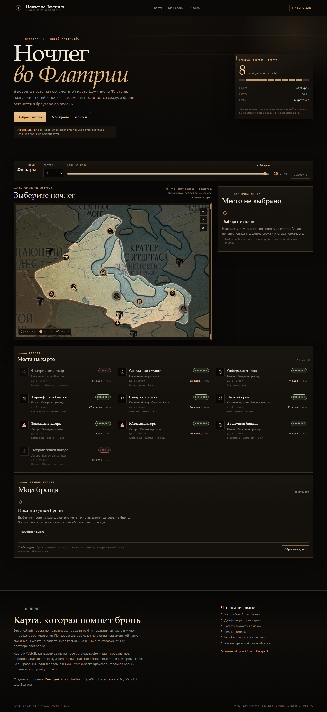

# Ночлег во Флатрии — практика 4

Учебный сайт с интерактивной картой и живым интерфейсом бронирования. Пользователь выбирает ночлег на пергаментной карте Доминиона Флатрия, задаёт число гостей и ночей, видит итоговую стоимость и подтверждает учебную бронь. Запись сохраняется в браузере и переживает обновление страницы.

**Стек:** SvelteKit 2, Svelte 5 (runes), TypeScript, Vite, `@sveltejs/adapter-static`, WebGL2, `localStorage`.



## Тема

**«Ночлег во Флатрии»** — учебная карта ночлегов в Доминионе Флатрия. Это прямой аналог темы «загородные дома» из задания, но вместо посёлка — пергаментная карта региона.

На карте десять объектов:

- постоялые дворы;
- охотничьи домики;
- башни;
- лагеря.

Два объекта — «Флатрихский двор» и «Пограничный лагерь» — заняты примерами с первого открытия. Их нельзя выбрать, пока не отменить бронь или не сбросить демо.

Цена считается как `цена за ночь × число ночей`. Гости влияют на доступность объекта, но не на сумму — так проще и честнее для учебной модели.

## Что реализовано

- Карта с десятью объектами и синхронным списком тех же объектов.
- Свободные, выбранные и занятые места различаются не только цветом: у них разные подписи, значки `✓` / `×`, форма и состояние в списке.
- Занятый объект нельзя выбрать: карта и список показывают сообщение.
- Два фильтра: число гостей и максимальная цена за ночь. Это компактная панель-строка над картой; фильтры одновременно обновляют карту, список и счётчик.
- При выборе открывается карточка: описание, регион, вместимость, удобства, форма гостей и ночей.
- Итоговая стоимость пересчитывается сразу при вводе.
- Валидация: гости — целое от 1 до вместимости, ночи — целое от 1 до 30. Ошибки показываются рядом с полями, бронь не создаётся.
- Подтверждение создаёт ровно одну запись. Повторное нажатие и двойной клик не создают дубликат.
- Раздел «Мои брони»: номер, объект, гости, ночи, сумма и дата. Отмена освобождает объект.
- Брони сохраняются в `localStorage` под одним ключом приложения и восстанавливаются после обновления.
- При повреждённых данных или запрете `localStorage` показывается понятное сообщение, страница не ломается.
- Кнопка «Сбросить демо» с подтверждением удаляет только брони приложения.
- Карта: перетаскивание, колесо/пинч, кнопки масштаба, сброс вида, hover-подсветка точек. Камера ограничена границами Доминиона, зум и панорамирование сглажены.
- При наведении точка получает золотое кольцо и отдельную WebGL-текстуру, курсор меняется на `pointer`. Hover определяется дешёвым distance test, а не отдельным pick-кадром.
- Производительность: DPR ограничен 1.5, дорогой blur-glow заменён лёгким hover-состоянием, кадры переиспользуются, canvas перерисовывается только при изменении камеры или сцены.
- Вне границ Доминиона карта притемняется; точки ночлегов остаются в foreground и не попадают под затемнение даже у самой границы.
- Вся карта — фон, затемнение, граница, ореолы и иконки точек — рендерится в WebGL. HTML отвечает только за список, карточку и элементы управления.
- Доступность: выбор с клавиатуры через кнопки списка, видимый фокус, подписи полей, `aria-live` для итогов и сообщений, поддержка `prefers-reduced-motion`.
- Адаптивная вёрстка: на компьютере карта и карточка рядом, на телефоне — друг под другом.
- Видимая подпись: «Учебное демо: бронирования сохраняются только в этом браузере. Реальная бронь не оформляется».

## Переиспользование карты из `gloat-svelte`

Карта взята из проекта **gloat-svelte** и адаптирована под статическую практику.

Что перенесено:

- `MapWebglRenderer` — WebGL2-рендеринг;
- `MapLightweightRenderer` — обёртка для встроенной карты без редактора;
- геометрия векторов, заливок, обводок и областей (`webgl-geometry.ts`);
- worker для расчёта геометрии (`webgl-geometry.worker.ts`);
- picking — определение объекта под указателем;
- зум, панорамирование, пинч, подсветка;
- типы сцены и векторных элементов;
- приём ограничения камеры конкретным регионом.

Что изменено:

- редакторские и тактические слои не подключены;
- сцена собирается из десяти объектов бронирования, а не из тактической карты;
- точки ночлегов — WebGL-символы с SVG-текстурами: четыре типа и четыре состояния (`free`, `hover`, `selected`, `occupied`);
- HTML-метки на canvas не используются: выбор на карте идёт через WebGL picking, клавиатурный выбор — через кнопки списка;
- вместо серверного API и базы — статический массив объектов и `localStorage`.

### Регион «Доминион Флатрия»

Использованы реальные данные региона из конфигурации исходной карты:

- полигон региона из 44 точек;
- границы региона: `minX 1333.13`, `minY 1509.41`, `maxX 2400.37`, `maxY 2281.15`;
- к границам добавлен отступ 6%;
- полигон пересчитан в координаты обрезанной карты;
- карта обрезана: исходник `4096×4296` → crop `2100×1600` с точки `(1050, 1300)`;
- итоговый файл `static/assets/map/flatria-region.webp` — `2100×1600`, ~1,24 МБ.

Полигон Доминиона используется как область фокуса WebGL-рендерера: снаружи карта притемняется, внутри остаётся яркой, по границе идёт золотая обводка. Камера ограничена его границами с отступом: пользователь не уезжает за пределы региона.

Точки ночлегов объявлены дочерними элементами региона. Поэтому focus-маска не притемняет их, даже если объект стоит ровно на границе, а символы и ореолы остаются в foreground.

Исходная карта содержит дороги, леса и подписи; WebGL-слой добавляет границу Доминиона, затемнение снаружи и символы ночлегов. Поэтому карта выглядит как артефакт, а не как схема из кружков.

Для стабильного FPS дорогой hover-glow (отдельный pick-кадр и два blur-прохода на каждое движение мыши) заменён лёгким hover-состоянием: кольцо и другая SVG-текстура. Сцена пересобирается только при входе курсора на точку или выходе с неё. DPR ограничен 1.5, камера использует retained WebGL-кадры, а canvas перерисовывается только когда меняется вид или состояние сцены.

## Запуск

```bash
cd web-practice-4
npm install
npm run dev
```

Откройте адрес, который выведет Vite (обычно `http://localhost:5173`).

Проверка типов и сборка:

```bash
npm run check
npm run build
npm run preview
```

Сборка для GitHub Pages:

```bash
npm run build:pages
npm run preview:pages
```

`BASE_PATH=/web-practice-4` задаётся в `package.json` через `cross-env`.

## Как проверить сценарий

1. Выберите свободный ночлег в списке или на метке карты.
2. Уменьшите число гостей или поднимите максимальную цену — карта и список должны совпасть по количеству.
3. Введите 0 ночей или гостей больше вместимости — появится ошибка, бронь не создастся.
4. Верните корректные значения и нажмите «Подтвердить бронь». Появится номер и сумма.
5. Обновите страницу — бронь и занятость объекта должны восстановиться.
6. Нажмите «Отменить бронь» — объект снова станет свободным.
7. Попробуйте выбрать занятый объект — появится сообщение, выбор не произойдёт.
8. Выберите объект и скройте его фильтром — выбор сбросится с пояснением.
9. Проверьте клавиатуру: `Tab` по списку, `Enter` для выбора, стрелки и `+`/`−` на карте.
10. Проверьте кнопки `+`, `−` и `⌂` на карте — они должны работать отдельно от перетаскивания.
11. Проверьте на телефоне: карта, карточка и список идут друг под другом; горизонтальной прокрутки нет.
12. Нажмите «Сбросить демо» и подтвердите — ваши брони исчезнут, два примера занятости останутся.

## localStorage

Ключ: `flatria-lodging-v1`.

Формат:

```json
{
  "version": 1,
  "bookings": [
    {
      "id": "uuid",
      "number": "NH-XXXX",
      "lodgingId": "flatrih",
      "lodgingName": "Флатрихский двор",
      "guests": 3,
      "nights": 4,
      "total": 56,
      "createdAt": "2026-10-29T12:36:15.224Z"
    }
  ]
}
```

При чтении записи валидируются. Незнакомые, дублирующиеся и ссылающиеся на занятые объекты записи пропускаются с предупреждением. Сброс удаляет только этот ключ, а не весь `localStorage`.

## Структура

```text
web-practice-4/
├── src/
│   ├── app.html                  # мета, шрифты, preload карты
│   ├── app.css                   # токены, кнопки, поля, базовая типографика
│   ├── lib/
│   │   ├── content.ts            # десять ночлегов, регион Флатрии, фильтры
│   │   ├── booking/
│   │   │   ├── types.ts          # Lodging, Booking, Filters
│   │   │   ├── logic.ts          # фильтры, валидация, сумма, склонения
│   │   │   ├── storage.ts        # localStorage и восстановление
│   │   │   └── map-scene.ts      # сцена WebGL: граница региона и объекты
│   │   ├── map/                  # перенесённое ядро карты gloat-svelte
│   │   └── components/           # Header, MapStage, Filters, List, Booking, Bookings, Footer
│   └── routes/
│       ├── +layout.ts            # prerender = true
│       ├── +layout.svelte        # мета и общий каркас
│       └── +page.svelte          # состояние, фильтры, бронь, localStorage
├── static/
│   ├── assets/map/flatria-region.webp
│   ├── assets/map/symbols/       # 16 WebGL-текстур: 4 типа × 4 состояния
│   └── fonts/
├── artifacts/                    # ТЗ и скриншоты
├── .github/workflows/deploy.yml
└── README.md
```

## Публикация на GitHub Pages

1. Создайте репозиторий `web-practice-4` на GitHub и загрузите проект в ветку `main`.
2. В настройках репозитория: **Settings → Pages → Build and deployment → Source: GitHub Actions**.
3. Workflow `.github/workflows/deploy.yml` соберёт сайт с `BASE_PATH=/web-practice-4` и опубликует папку `build`.
4. Адрес: `https://ixniyevonn.github.io/web-practice-4/`.

Если репозиторий называется иначе, измените base path в `package.json` и `svelte.config.js`.

## Нейросеть и промпты

Проект сделан с помощью **DeepSeek**. Основные промпты:

1. «Собери SvelteKit SSG для практики 4: интерактивная карта ночлегов во Флатрии. Десять объектов, цена за ночь, гости, фильтры по вместимости и цене, карточка, расчёт, подтверждение, отмена, localStorage, адаптив и клавиатура».
2. «Переиспользуй WebGL-карту из gloat-svelte: рендерер, геометрию, worker, picking, зум и пан. Оставь только ядро без редактора. Ограничь карту полигоном региона „Доминион Флатрия“ из конфигурации карты. Сделай focus-режим: затемни всё снаружи полигона, а точки ночлегов оставь в foreground. Точки, их состояния и границу региона рендери в WebGL, без HTML-меток на canvas».
3. «Добавь валидацию гостей и ночей, защиту от двойного подтверждения, восстановление броней, обработку повреждённого localStorage, сброс демо с подтверждением и сообщения об ошибках. Не ломай уже работающие фильтры и карту».

## Ограничения

- Это учебное демо: реальная бронь, оплата, регистрация и сервер отсутствуют.
- Данные хранятся только в текущем браузере; в другом браузере или после очистки данных их не будет.
- Два занятых объекта — демонстрационные, а не реальные брони.
- Названия ночлегов — учебные демо-топонимы; они не являются каноном исходного проекта.
- Карта — художественная карта проекта; она не претендует на географическую точность.
